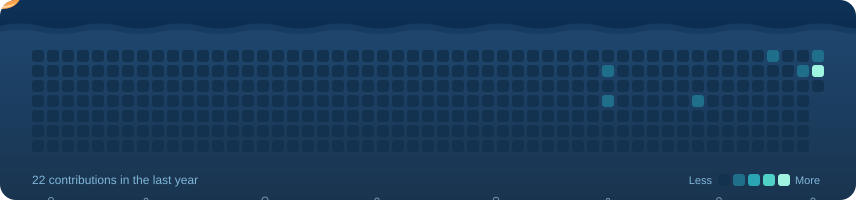
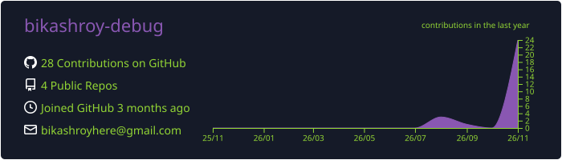
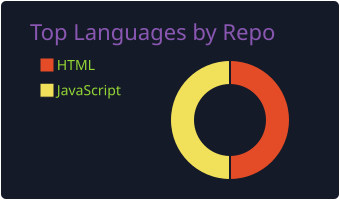
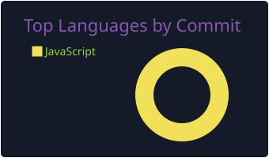
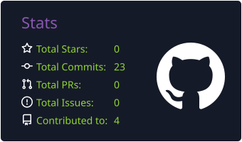
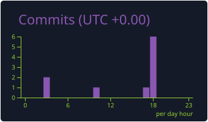

<!--
  GITHUB PROFILE README
  Owner: Bikash Roy
  Repository: bikashroy-debug
-->

<div align="center">

<!-- ANIMATED HEADER -->


<a href="https://github.com/bikashroy-debug">
  
</a>

<p>
  
  
</p>

</div>

---

## 👨‍💻 About Me

```javascript
const bikash = {
    name: "Bikash Roy",
    role: "Aspiring Full-Stack Developer",
    education: "BCA Student",
    currentlyLearning: [
        "JavaScript",
        "Frontend Development",
        "Backend Development"
    ],
    interests: [
        "Web Development",
        "Software Engineering",
        "Artificial Intelligence",
        "Automation"
    ],
    mindset: "Learn → Build → Improve → Repeat"
};
```

- 🌱 Currently strengthening my JavaScript and web development fundamentals.
- 💻 Interested in building useful, responsive, and interactive applications.
- 🧠 Focused on problem-solving and writing clean, maintainable code.
- 🚀 Working towards becoming a Full-Stack Developer.
- 🤝 Open to learning, collaboration, and hackathon opportunities.

---

## ⚡ Tech Stack & Tools

### Languages

<p>
  
</p>

### Frontend Development

<p>
  
</p>

### Tools & Platforms

<p>
  
</p>

### Exploring Next

<p>
  
</p>

---

## 📈 My Learning Journey

<div align="center">

| Technology | Current Focus |
|:---|:---|
| HTML5 | Semantic structure |
| CSS3 | Responsive design & animations |
| JavaScript | ES6+, DOM & asynchronous JS |
| Git & GitHub | Version control & collaboration |
| React | Planned |
| Node.js & Express | Planned |
| MongoDB | Planned |

</div>

---

## 🚀 Featured Projects

<div align="center">

<a href="https://github.com/bikashroy-debug?tab=repositories">
  
</a>

</div>

> I believe projects are the best way to demonstrate what I can actually build. More projects coming as I continue learning.

---

## 🐟 My Contribution Pond

<div align="center">



</div>

---

## 📊 GitHub Analytics

<div align="center">









</div>

---

## 🎯 2026 Goals

- [ ] Become confident in JavaScript.
- [ ] Build and deploy real-world web applications.
- [ ] Learn React and modern frontend development.
- [ ] Learn backend development with Node.js and Express.
- [ ] Understand databases and API development.
- [ ] Improve DSA and problem-solving skills.
- [ ] Participate in hackathons and open-source projects.

---

## 🤝 Let's Connect

<div align="center">

<a href="https://github.com/bikashroy-debug">
  
</a>

<!-- Add your LinkedIn URL when available -->
<!-- Add your portfolio website when available -->

<br/><br/>

### 💬 Always learning. Always building.

**"The best way to predict the future is to build it."**


</div>
